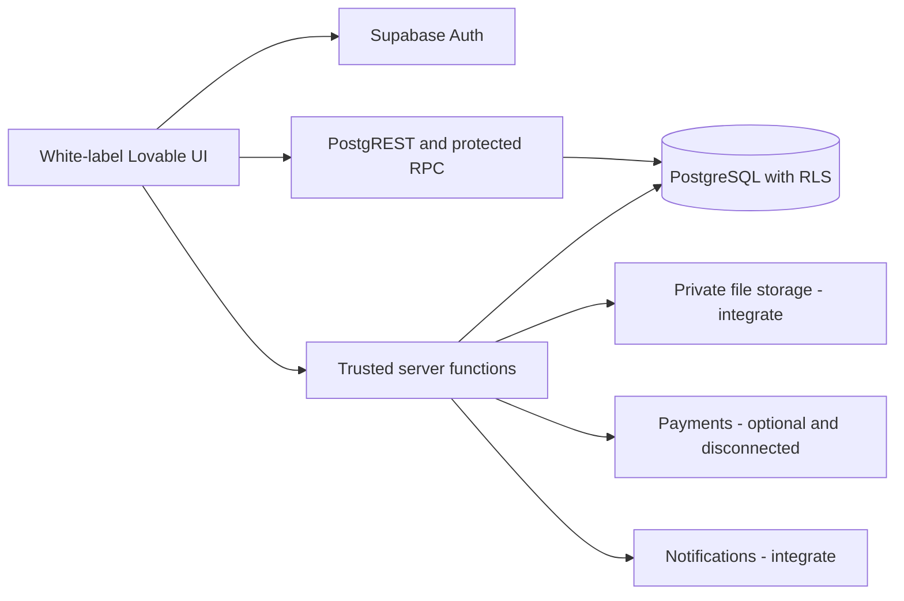
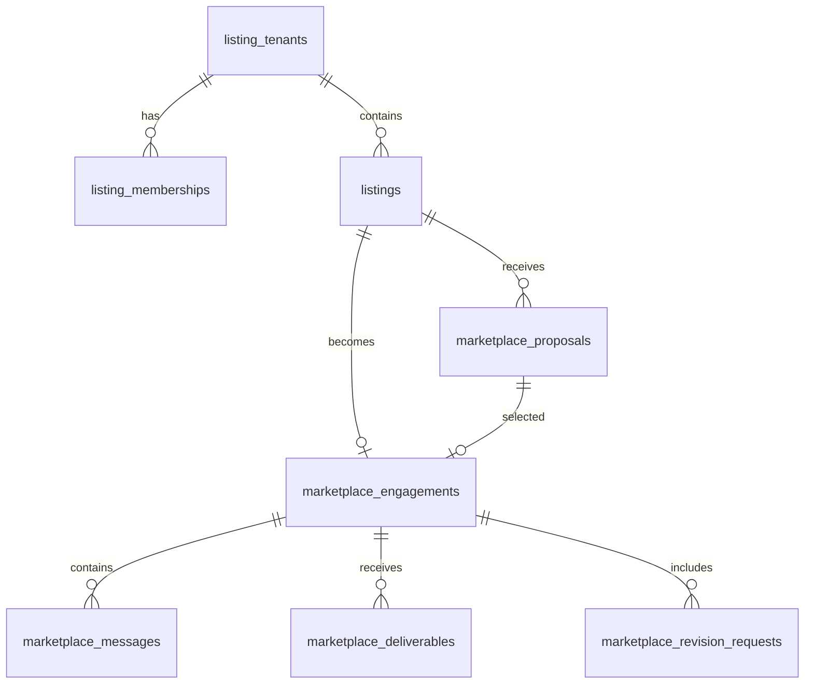

# Generic marketplace architecture

## Core contracts

- Identity: Supabase Auth; tenant membership in `listing_memberships`.
- Catalog: `listings` and `listing_categories`; review workflow from migration 001.
- Budget: `listings.budget_mode`, existing `price_minor`, optional `budget_max_minor`.
- Proposals: `marketplace_proposals`, with provider as per-listing actor, not an account-wide exclusive role.
- Engagement: `marketplace_engagements`, created only by an atomic acceptance RPC; one per listing.
- Collaboration: `marketplace_messages`, `marketplace_deliverables`, `marketplace_revision_requests`.
- Oversight: `marketplace_reports`, `marketplace_events`.
- Out-of-process providers: notification, private storage, malware scanning and payment integrations.

## Important design distinctions

Account roles are tenant moderator rights, **not** purchaser/provider identities. A person can post a request, apply to another request and be a moderator only where separately authorized.

Publication status is not work status. A listing can be archived and still have an active engagement. Completion is not a payment receipt.

The SQL enforces basic tenant participation, one engagement per listing, private correspondence and proposal acceptance. It does **not** provide storage bucket policies, an independent audit service, transaction processing, KYC, dispute resolutions, payouts, complete moderation tooling or regulatory coverage.

Use additive SQL migrations and a versioned server API for new capabilities. No client-only role or transaction checks.
