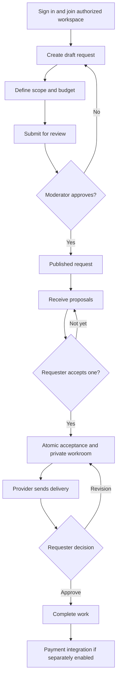
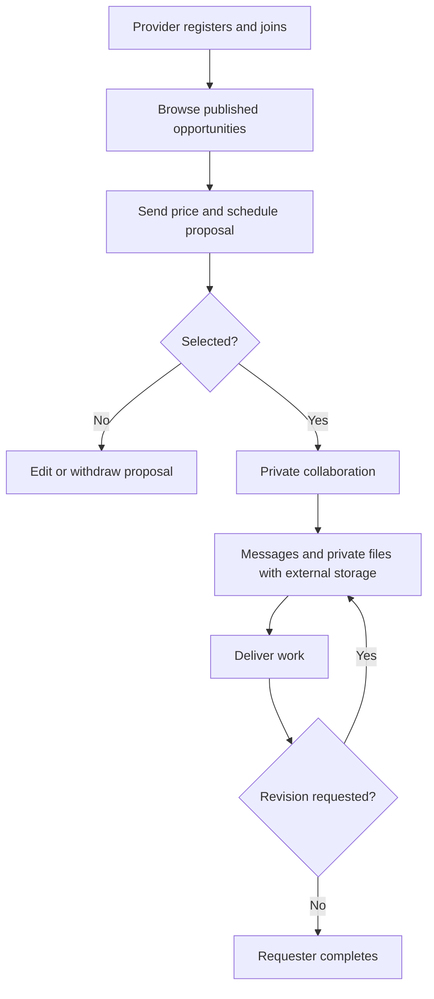
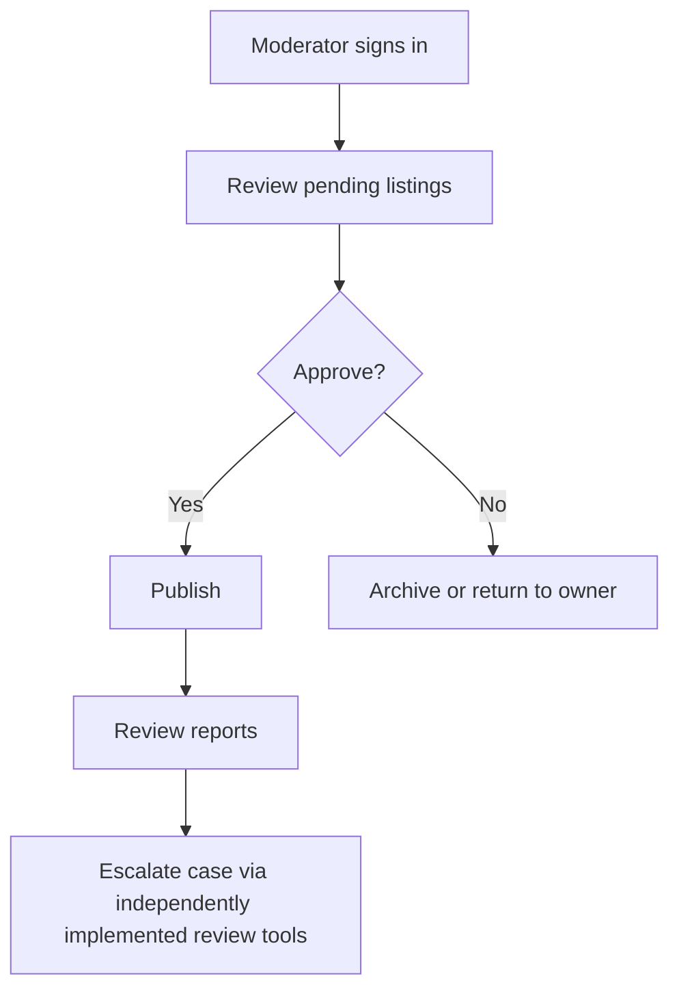

# User, provider and admin journeys

## Failure branches to implement and verify

- Unauthorized publication or membership -> reject server-side.
- Proposal on own listing, closed listing or across tenants -> reject.
- Concurrent accepts -> row locking and unique engagement constraint prevent double acceptance.
- Direct updates to protected engagement states -> deny; use guarded RPCs.
- Private file upload/download -> require authenticated, tenant-scoped storage policies, validation and scanning.
- Disputes/refunds -> preserve records; use verified payment provider reconciliation, not work status as proof of payment.
- Abusive messages/reports -> rate controls, moderation and support workflows still required.
